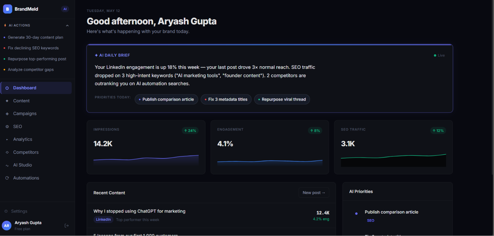

<div align="center">
  
</div>

# BrandMeld — Release-to-Revenue Intelligence

> **"Distribution is the #1 startup killer. Better product loses to better distribution, every single time."**

BrandMeld is evolving from a founder distribution engine into a **release-to-revenue system for product-led B2B software**. It starts by turning a meaningful product signal into an approved distribution campaign, then expands toward release impact, customer adoption, migrations, and measurable revenue outcomes.

The product is intentionally being built in stages: the initial workflow validates signal analysis and human-approved actions; the later release-intelligence workflow will ingest GitHub releases, documentation changes, product analytics, and support context.

<div align="center">
  
</div>

---

## 🎯 Product Direction

### Initial workflow

```text
Signal → Context → Recommendation → Human approval → Action → Outcome
```

The first vertical slice accepts a manual product or release signal, analyzes its likely customer impact, and produces evidence-backed recommendations. External actions remain behind an explicit approval gate.

### Target product

```text
Release → Affected users/accounts → Migration or adoption action → Measured outcome
```

The initial market is product-led B2B software that ships frequently and has measurable adoption: SaaS, API products, developer tools, infrastructure, data, AI, and security products. The first beachhead is technical products with documentation, changelogs, and recurring releases.

### Current implementation status

- ✅ Rust backend foundation with modular health/readiness routes
- ⏳ Signal domain model and analysis workflow
- ⏳ Next.js frontend dashboard
- ⏳ GitHub, changelog, product analytics, and support integrations
- ⏳ Release impact and adoption tracking

The legacy Python implementation is archived under `legacy/backend-python/`. The active backend direction is the Rust service foundation, and the frontend is planned as a separate implementation slice.

---

## 🔁 The Distribution Flywheel

```
Signal → Draft → Refine → Distribute → Measure
  ↑                                         │
  └─────────────── (weekly loop) ───────────┘
```

| Step | Section | Route | What it does |
|---|---|---|---|
| ⚡ | **Signal** | `/discover` | Pick what happened this week worth distributing |
| ✦ | **Draft** | `/plan` | AI generates your distribution — streams word-by-word |
| ✏ | **Refine** | `/create` | Edit, tone-adjust, perfect before sending |
| 📡 | **Distribute** | `/publish` | One click → LinkedIn + X + Newsletter simultaneously |
| 📊 | **Measure** | `/learn` | What reached people? Analytics feed back into next week |

---

## 🚀 What's New (Distribution Engine v2)

### ⚡ Real-Time Streaming Generation
Content now types out word-by-word as it's generated, like ChatGPT. Signal metadata (hook, audience, tone) appears the moment extraction completes, so you're never staring at a blank screen. Powered by NVIDIA NIM SSE streaming with graceful non-streaming fallback.

### 📡 One-Click Multi-Channel Distribution
After your post is generated, click **"⚡ Distribute Now"** to fire a modal showing all your connected channels (LinkedIn, X, Newsletter, Instagram coming soon). Check the channels you want, click once — BrandMeld pushes to all of them simultaneously with live per-channel status feedback.

### 📊 Distribution Stats Strip
The Signal page now shows your weekly distribution dashboard at a glance: posts this week, current streak, total distributed, and which channels you've used. Keeps you accountable and coming back weekly.

### 🔐 Security Fixes (P0)
- **BUG-2 fixed**: `user_id` removed from all request bodies — always derived server-side from JWT
- **BUG-3 fixed**: Brand voice override now persists to Supabase, not `localStorage` (was lost on every page reload)
- **Router fixed**: `/settings` now correctly routes to the full Settings Hub with all 4 tabs active

### 🎨 Settings Hub — 4 Live Tabs
| Tab | What's inside |
|---|---|
| **Brand DNA** | URL scanner + editable voice override → saved to Supabase |
| **Connected Channels** | LinkedIn OAuth (live), X (web intent), Instagram (coming soon) |
| **Voice Marketplace** | Fork a top founder's voice profile |
| **Account** | Profile, plan, sign out |

---

## 🏗️ Architecture

```
BrandMeld-CloudRunHackathon/
├── legacy/backend-python/        # Archived Python FastAPI implementation
│   ├── app/
│   │   ├── core/
│   │   │   ├── llm.py            # NVIDIA NIM client factory + retry helper
│   │   │   └── config.py         # Environment configuration
│   │   ├── routers/
│   │   │   ├── autopilot.py      # POST /engine/autopilot + SSE /stream + GET /analytics/summary
│   │   │   ├── publishing.py     # POST /publish/post — LinkedIn OAuth + X web intent
│   │   │   └── ...               # campaign, analytics, marketplace, prompts
│   │   ├── services/
│   │   │   ├── engine.py         # Brand DNA scraping (Playwright + NVIDIA vision)
│   │   │   ├── voice_service.py  # Authenticity scoring
│   │   │   └── publishing_service.py  # Token encryption + platform dispatch
│   │   └── main.py
│   ├── database/schema.sql       # Full Supabase schema (RLS, oauth_state table)
│   └── requirements.txt
├── backend-rs/                    # New Rust API boundary
│   ├── Cargo.toml
│   └── src/
│       ├── config.rs              # Environment-backed service configuration
│       ├── error.rs               # Typed configuration errors
│       ├── main.rs                # Small application bootstrap
│       ├── state.rs               # First-slice in-memory state
│       ├── domain/                # Signals and classification contracts
│       └── http/
│           ├── auth.rs            # Bearer token protection
│           ├── health.rs          # /health and /ready endpoints
│           └── signals.rs         # /v2 signal and classification routes
└── frontend/                     # Planned Next.js + TypeScript dashboard
```

---

## 📡 API Reference

The `/v1` endpoints below describe the archived distribution-engine API for reference. They are not part of the active runtime. The first release-intelligence endpoints are now available under `/v2` in the Rust service.

### Active Rust signal API

| Method | Path | Description |
|---|---|---|
| `POST` | `/v2/signals` | Create a validated signal |
| `GET` | `/v2/signals/{id}` | Read a signal |
| `POST` | `/v2/signals/{id}/classify` | Classify a signal with evidence and confidence |
| `POST` | `/v2/signals/mock-github-release` | Create a development fixture |

These routes require `Authorization: Bearer <BRANDMELD_API_TOKEN>`.

All endpoints require `Authorization: Bearer <supabase_jwt>` (user_id always derived from JWT, never from request body).

### Autopilot Engine
| Method | Path | Description |
|---|---|---|
| `POST` | `/v1/engine/autopilot` | Generate post from signal (non-streaming) |
| `POST` | `/v1/engine/autopilot/stream` | Generate post as SSE stream (word-by-word) |
| `GET` | `/v1/engine/analytics/summary` | Distribution stats for current user |

### Campaign & Brand DNA
| Method | Path | Description |
|---|---|---|
| `POST` | `/v1/campaign/onboard` | Scrape URL → extract Brand DNA → store in Supabase |
| `POST` | `/v1/campaign/launch` | Batch generation for X + LinkedIn + Instagram |
| `POST` | `/v1/campaign/edit` | AI-directed draft revision |
| `GET` | `/v1/campaign/watchdog` | Poll for new products on a URL |

### Publishing & OAuth
| Method | Path | Description |
|---|---|---|
| `POST` | `/v1/publish/post` | Publish to connected platforms |
| `GET` | `/v1/connect/linkedin` | Generate LinkedIn OAuth URL |
| `GET` | `/v1/connect/linkedin/callback` | Handle LinkedIn OAuth callback |
| `GET` | `/v1/publishing/connected` | List connected social accounts |

### Onboarding & Status
| Method | Path | Description |
|---|---|---|
| `GET` | `/v1/onboarding/status` | Check if user has Brand DNA + connected accounts |

---

## 🛠️ Local Setup

### Prerequisites
- Python 3.11+, Node.js 18+
- Supabase account (auth + database)
- NVIDIA NIM API key (generate at [build.nvidia.com](https://build.nvidia.com))

### Environment Variables

**`legacy/backend-python/.env`**
```env
# NVIDIA NIM (required for all AI features)
NVIDIA_API_KEY=nvapi-...
NVIDIA_MODEL_ID=nvidia/llama-3.1-nemotron-70b-instruct

# Supabase
SUPABASE_URL=https://your-project.supabase.co
SUPABASE_SERVICE_ROLE_KEY=your_service_role_key
JWT_SECRET=your_supabase_jwt_secret

# LinkedIn OAuth
LINKEDIN_CLIENT_ID=your_linkedin_client_id
LINKEDIN_CLIENT_SECRET=your_linkedin_client_secret
LINKEDIN_REDIRECT_URI=http://localhost:8080/v1/connect/linkedin/callback

# Token encryption (generate: python -c "from cryptography.fernet import Fernet; print(Fernet.generate_key().decode())")
FERNET_KEY=your_fernet_key

PORT=8080
```

**`frontend/.env.local`**
```env
VITE_API_URL=http://localhost:8080
VITE_SUPABASE_URL=https://your-project.supabase.co
VITE_SUPABASE_ANON_KEY=your_anon_key
```

### Database Setup

Run [schema.sql](./legacy/backend-python/database/schema.sql) in your Supabase SQL editor. Includes:
- `brand_dna` — extracted brand voice per user
- `autopilot_drafts` — all generated posts with signal metadata
- `published_posts` — distribution history per channel
- `social_connections` — encrypted OAuth tokens
- `oauth_state` — HMAC-signed state tokens for secure OAuth flow
- Row-Level Security policies on all user tables

### Run Locally

**Active Rust API:**

```powershell
cd backend-rs
$env:BRANDMELD_API_TOKEN = "local-dev-token"
cargo run
# → http://127.0.0.1:8081
```

Signal routes require `Authorization: Bearer local-dev-token`.

The Python commands below run the archived implementation only.

```bash
# Backend
cd legacy/backend-python
python -m venv .venv
.venv\Scripts\activate       # Windows
pip install -r requirements.txt
python -m uvicorn app.main:app --reload --port 8080

# Frontend (new terminal)
cd frontend
npm install
npm run dev
# → http://localhost:5173
```

---

## ☁️ Deployment

The Rust service now supports Cloud Run’s `PORT` variable and binds to
`0.0.0.0`, but a Rust container and deployment script are not added yet.

---

## 🧪 Tests

```bash
cd backend-rs
cargo fmt --check
cargo test
```

The archived Python test suite can still be run separately:

```bash
cd legacy/backend-python
python -m pytest tests/ -v
```

---

## 🏆 Competitive Edge

| Tool | What they do | Gap |
|---|---|---|
| Taplio | LinkedIn AI writer | Single platform. No distribution system. |
| Buffer AI | Scheduling | Generic AI. No brand voice DNA. |
| Jasper | Long-form writing | No distribution, no publishing, no analytics. |
| Postwise | Twitter AI | Single platform. No system. |
| **BrandMeld** | **Full distribution engine** | Brand voice → Signal detection → Multi-channel blast → Analytics → Repeat. The whole loop. |

The moat isn't the AI writing. The moat is the **flywheel**: every distribution event makes BrandMeld smarter about what works for that specific founder.

---

**BrandMeld — Your Weekly Distribution Engine.** ⚡
